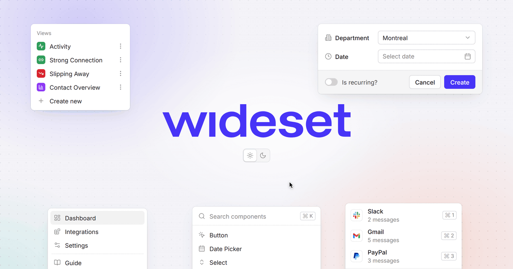

<div align="center">



# Wideset

An open source React design system with a matching Figma library, <br/> built for the people and the coding agents who ship product UI together.

**Public beta** · Built on [React 18+](https://react.dev), [Radix](https://www.radix-ui.com) and [Tailwind CSS v4](https://tailwindcss.com)

[](https://www.npmjs.com/package/@wideset/react)
[](LICENSE)
[](https://github.com/widelab-co/wideset/actions/workflows/build.yaml)
[](CONTRIBUTING.md)

[](https://wideset-docs.widelab.workers.dev)
[](https://wideset-storybook.widelab.workers.dev)
[](https://wideset-docs.widelab.workers.dev/docs/cli)
[](https://wideset-docs.widelab.workers.dev/docs/ai)

**[Docs](https://wideset-docs.widelab.workers.dev)** · **[Storybook](https://wideset-storybook.widelab.workers.dev)** · **[npm](https://www.npmjs.com/package/@wideset/react)** · **[Contributing](CONTRIBUTING.md)** · **[Discussions](https://github.com/widelab-co/wideset/discussions)**

</div>

## Overview

Wideset is the design system [Widelab](https://widelab.co) builds client products with. It ships
53 accessible React components, a token system with dark mode and rebranding through CSS
variables, and a Figma library the code matches.

- **Two ways in.** Install `@wideset/react` and get fixes through semver, or copy a component's
  source into your repo with the shadcn CLI and own it from then on.
- **Sits next to your stack.** Every token class carries a `ws` prefix (`p-ws-4`,
  `bg-ws-dynamic-primary-default`), so Wideset never overrides your Tailwind config or shadcn
  theme.
- **Rebrand without forking.** A brand is a set of CSS variable overrides; components follow, in
  light and dark.
- **Composition over configuration.** Components take subcomponents, not config props:
  `<Button>Continue<Button.Icon icon={RiArrowRightLine} /></Button>`. Every part has a named
  export, so React Server Components work.
- **Ready for coding agents.** Every docs page has a Markdown version and `/llms.txt`, the registry
  works with the shadcn MCP server, and Agent Skills teach Claude Code, Cursor and Codex which
  component fits and what a finished screen looks like.

## Getting started

Wideset needs **React 18 or 19** (`react` and `react-dom` are peer dependencies). Icons come from
[Remix Icon](https://remixicon.com).

```bash
npm install @wideset/react @remixicon/react
# or
pnpm add @wideset/react @remixicon/react
```

Import the stylesheet once, at your app's entry point. Without Tailwind, add the reset too:

```tsx
import '@wideset/react/styles';
import '@wideset/react/preflight'; // only if your app does not use Tailwind
```

Load a font and apply it (Wideset ships `--font-ws-sans`, Inter with a system fallback):

```css
body {
  font-family: var(--font-ws-sans);
}
```

Then use a component:

```tsx
import { RiArrowRightLine } from '@remixicon/react';
import { Button } from '@wideset/react';

export function Continue() {
  return (
    <Button>
      Continue
      <Button.Icon icon={RiArrowRightLine} />
    </Button>
  );
}
```

The **[installation guide](https://wideset-docs.widelab.workers.dev/docs/installation)** covers
Tailwind v4, Next.js and Server Components, and fonts; the
**[package README](packages/design-system/README.md)** has the same in one page.

### Copy the source instead

Wideset is also a [shadcn registry](https://ui.shadcn.com/docs/registry). In a project that
already has a `components.json`, register the namespace and add components; the files land in
your repo under `components/ui/wideset/`:

```bash
npx shadcn@latest registry add @wideset=https://wideset-docs.widelab.workers.dev/r/{name}.json
npx shadcn@latest add @wideset/button
```

A new project needs no `shadcn init`, only a `components.json`; the
**[CLI guide](https://wideset-docs.widelab.workers.dev/docs/cli)** has one for Vite and Next.js.

### Working with AI

```bash
npx skills add widelab-co/wideset/packages/skills
```

installs four Agent Skills (setup, build, craft, review) for the agents you use. Docs as Markdown
(`/llms.txt`, `/components/<name>.md`), the shadcn MCP server and a rules block to paste are on
**[Working with AI](https://wideset-docs.widelab.workers.dev/docs/ai)**.

## Packages

| Package                                    | Description                                                                        | README                                     |
| ------------------------------------------ | ---------------------------------------------------------------------------------- | ------------------------------------------ |
| [`@wideset/react`](packages/design-system) | Components, tokens and stylesheets, the shadcn registry, and the `wideset` CLI     | [README](packages/design-system/README.md) |
| [`@wideset/skills`](packages/skills)       | Agent Skills and rules for coding agents, generated from the library's usage specs | [README](packages/skills/README.md)        |
| [`apps/docs`](apps/docs)                   | The documentation site (Astro), with the registry and `llms.txt`                   | [README](apps/docs/README.md)              |

> `@wideset/skills` is not on npm yet: install the skills with `npx skills add` or the registry
> item, as above. The `wideset` CLI ships inside `@wideset/react`; run it as
> `npx --no-install wideset` until the `wideset` package is published.

## Project structure

| Path                            | Purpose                                                                   |
| ------------------------------- | ------------------------------------------------------------------------- |
| `packages/design-system/src/`   | Components, styles and tokens; one folder per component                   |
| `packages/design-system/specs/` | Usage guidance per component and pattern, read by the docs and the skills |
| `packages/design-system/cli/`   | The `wideset` CLI                                                         |
| `packages/skills/`              | Agent Skills, their build and evals                                       |
| `apps/docs/`                    | Documentation site                                                        |
| `.agents/skills/`               | Skills for contributors: code review, conventions, docs                   |

## Contributing

Contributions are welcome. Start with **[CONTRIBUTING.md](CONTRIBUTING.md)**; the conventions for
people and coding agents are in **[AGENTS.md](AGENTS.md)**, and releases in
**[RELEASING.md](RELEASING.md)**. Questions go to
**[Discussions](https://github.com/widelab-co/wideset/discussions)**, bugs to
**[Issues](https://github.com/widelab-co/wideset/issues)**.

The repository is a pnpm workspace run by Turborepo. You need **Node 22.13+** (`.nvmrc`) and
**pnpm** (the version is pinned in `package.json`; `corepack enable` installs it):

```bash
corepack enable
pnpm install
pnpm storybook    # http://localhost:6006
pnpm test
```

## Security

Report vulnerabilities privately, as described in **[SECURITY.md](SECURITY.md)**. Please do not
open a public issue.

## License

[Apache License 2.0](LICENSE). Keep [`NOTICE`](NOTICE) with any copy or derivative you
redistribute. The license grants no rights to the Wideset or Widelab names.
